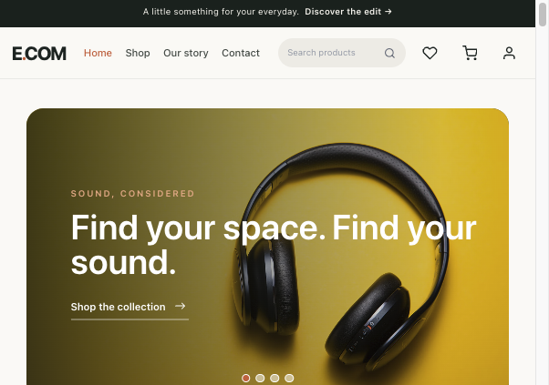
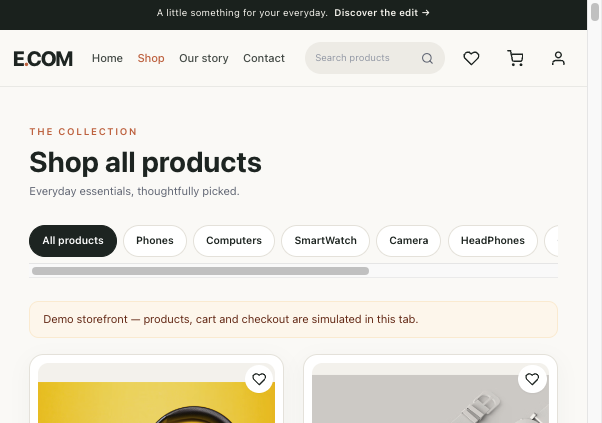
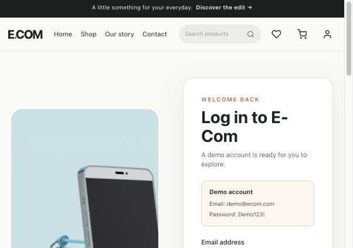

# E-Com — Frontend Store Demo

A polished, frontend-only storefront built with React. Browse a sample catalog, try a tab-scoped demo account, and walk through a simulated shopping flow. There is no backend or commerce API, payment processor, or required environment configuration. Avatar and product images load from third-party image services.

Maintainer: [Bajrang Vaishnav](https://github.com/BajrangVaishnav)

> **GitHub Pages:** The site will be available at [https://bajrangvaishnav.github.io/E-commerce-website/](https://bajrangvaishnav.github.io/E-commerce-website/).

## Screenshots

| Storefront | Product catalog |
| --- | --- |
|  |  |



## Features

- Responsive storefront, sample product catalog, product details, categories, and search
- Wishlist, cart, quantity controls, and simulated checkout with demo order history
- Local Razorpay-style payment screen with selectable success/failure demo outcomes
- Floating FAQ assistant that answers common questions locally without an AI service or API
- Static demo sign-in and sign-up flows with client-side form validation
- Profile editing, contact form, and newsletter form using browser-only demo data
- `sessionStorage` keeps demo data scoped to the current tab and across refreshes
- Sample credentials are provided on the sign-in page
- No real payments, messages, subscriptions, or account creation are sent

## Technology stack

- React 18 and Create React App
- React Router
- Tailwind CSS and project styles
- React Icons and React Toastify

## Getting started

### Requirements

- Node.js 18 or newer
- npm

### Install and run

```sh
git clone https://github.com/BajrangVaishnav/E-commerce-website.git
cd E-commerce-website
npm install
npm start
```

Open [http://localhost:3000](http://localhost:3000) in your browser.

### Demo account

```text
Email:    demo@ecom.com
Password: Demo123!
```

You can also create a demo account from the sign-up page. Submitted passwords are not stored.

### Environment variables

No environment variables are required. See [`.env.example`](./.env.example). Any `REACT_APP_*` value used in a Create React App build is included in client-side code and must not contain secrets.

### Available scripts

```sh
npm start                 # start the development server
npm test -- --watchAll=false
npm run build             # create a production build
```

## Deploy to GitHub Pages

The included GitHub Actions workflow deploys the production build whenever changes are pushed to `main`.

1. Push this project to the `main` branch on GitHub.
2. In the repository, open **Settings → Pages** and set **Build and deployment → Source** to **GitHub Actions**.
3. Wait for the **Deploy to GitHub Pages** workflow to finish in the **Actions** tab.
4. Open [https://bajrangvaishnav.github.io/E-commerce-website/](https://bajrangvaishnav.github.io/E-commerce-website/).

The workflow creates a `404.html` fallback so React routes work on refresh. The site uses sample data only; the existing non-commercial license and third-party image terms still apply.

## Security and privacy notes

- This is a UI prototype, **not** real authentication or a secure commerce application. Client-side checks and `sessionStorage` can be inspected or changed by the person using the browser.
- Do not enter real credentials, personal information, or payment details. Checkout is simulated and does not charge a payment method.
- The Razorpay-style screen is a local visual simulation only; it does not load a gateway SDK or send payment requests.
- The help assistant matches questions against bundled FAQs in the browser; it does not send chat messages to an AI service.
- Demo profile and shopping data are stored in the current tab's `sessionStorage`. Browsers usually discard it when the tab closes, but session restoration behavior varies.
- The signed-in profile avatar is served by [DiceBear](https://www.dicebear.com/) and uses the account email as its URL seed. This sends the email to that third-party service in the image request. Use a non-identifying seed or remove the external avatar if that is not acceptable.
- Product and collection photography may load from [Unsplash](https://unsplash.com). Some bundled images do not yet have documented provenance. Check each asset's rights before redistributing it; this project's license does not replace third-party licenses.

## Contributing

See [`CONTRIBUTING.md`](./CONTRIBUTING.md) for setup, testing, and contribution expectations.

## License

This project is distributed under the [PolyForm Noncommercial License 1.0.0](./LICENSE). It is source-available, **not OSI-approved open-source**; commercial use is not permitted under these terms. Review the license before using or sharing the project.
